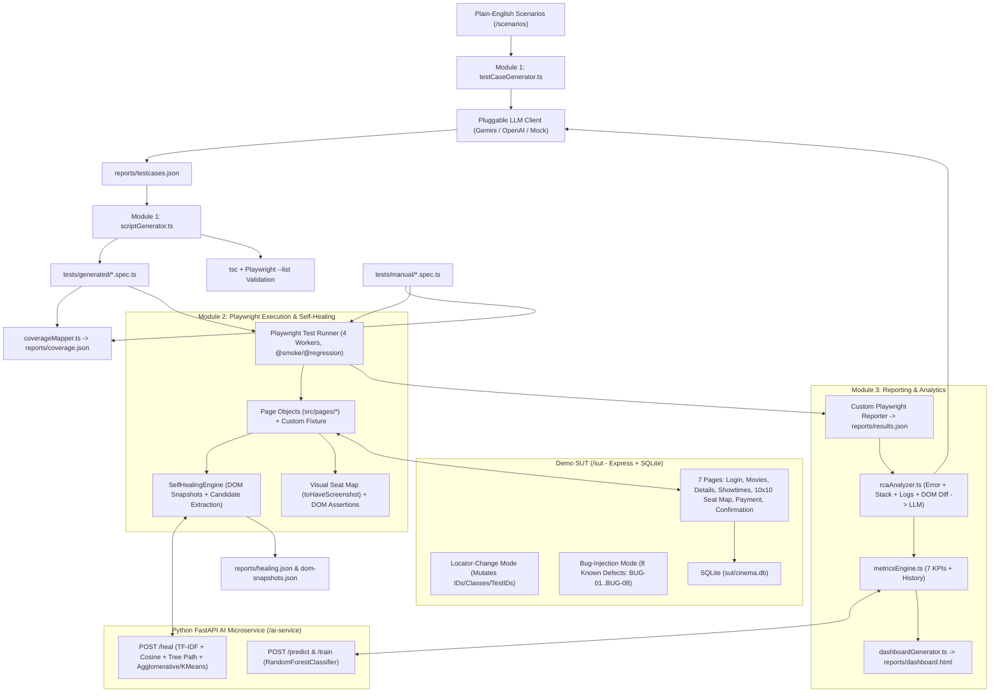

# AI-Powered Intelligent Software Testing Framework for Movie Ticket Booking Applications Using Hybrid AI and Playwright Automation

An end-to-end, hybrid AI test automation framework combining **LLM-driven test design & script generation**, **Playwright + TypeScript Page Object Model with visual & DOM testing**, a **Python FastAPI + scikit-learn microservice** for **ML self-healing locators (TF-IDF + cosine similarity + DOM tree path + Agglomerative/KMeans clustering)** and **RandomForest bug prediction**, **AI Root-Cause Analysis (RCA)**, and an **interactive HTML intelligence dashboard**.

---

## System Architecture



---

## Project Structure

```
movie-ticket-ai-testing/
├── sut/                          # Demo Movie Ticket Booking SUT (Express + SQLite)
│   ├── db.js                     # SQLite schema & deterministic seed data (6 movies, 10x10 seats)
│   ├── server.js                 # REST API with locatorChange & bugInjection runtime flags
│   └── public/                   # 7-view SPA (index.html, styles.css, app.js)
├── ai-service/                   # Python FastAPI + scikit-learn microservice
│   ├── main.py                   # /health, /heal, /train, /predict endpoints
│   ├── healing_engine.py         # TF-IDF + Cosine + Tree Path + Agglomerative/KMeans clustering
│   ├── bug_predictor.py          # RandomForestClassifier bug risk predictor
│   └── requirements.txt
├── scenarios/                    # 10 plain-English movie booking user scenarios
├── src/
│   ├── config.ts                 # Centralized env/path configuration
│   ├── types/index.ts            # Shared TypeScript interfaces
│   ├── ai/
│   │   ├── llmClient.ts          # Pluggable Gemini / OpenAI / Mock LLM client
│   │   ├── testCaseGenerator.ts  # Scenario -> schema-validated reports/testcases.json
│   │   ├── scriptGenerator.ts    # testcases.json -> tests/generated/*.spec.ts + tsc/dry-run check
│   │   ├── coverageMapper.ts     # Page/feature coverage -> reports/coverage.json
│   │   └── rcaAnalyzer.ts        # Failure telemetry -> LLM RCA -> reports/rca.json
│   ├── pages/                    # Centralized Page Object classes for all 7 pages
│   ├── fixtures/
│   │   ├── selfHealing.ts        # DOM snapshot recorder + FastAPI /heal client
│   │   └── testFixture.ts        # Custom Playwright fixture with console/network/DOM capture
│   ├── reporters/
│   │   └── customReporter.ts     # Custom Playwright reporter -> reports/results.json
│   └── reporting/
│       ├── metricsEngine.ts      # Computes all 7 metrics + calls /predict
│       └── dashboardGenerator.ts # Builds interactive Chart.js reports/dashboard.html
├── tests/
│   ├── manual/                   # Hand-written baseline & visual seat-map specs
│   └── generated/                # Auto-generated Playwright specs from Module 1
├── scripts/                      # setup, start:sut, start:ai, report, and run:all pipeline
└── reports/                      # JSON reports & interactive HTML dashboard
```

---

## Demo SUT Features & 8 Injected Defects

The **CineBook Pro** SUT (`/sut`) implements 7 complete pages: **Login**, **Movie List**, **Movie Details**, **Showtime/Theatre Selection**, **10×10 Seat Map** (available / selected / booked states), **Mock Payment**, and **Booking Confirmation**.

- **Locator-Change Mode** (`LOCATOR_CHANGE=true` or `?locatorChange=true`): Renames element `id`, `data-testid`, and CSS class attributes across all 7 pages to refactored `*-v2` identifiers to simulate breaking UI changes.
- **Bug-Injection Mode** (`BUG_INJECTION=true` or `?bugs=true`): Activates 8 known defects:

| Bug ID | Code | Module | Injected Fault Behavior |
| :--- | :--- | :--- | :--- |
| `BUG-01` | `booked_seat_selectable` | SeatMap | Pre-booked seats become clickable/selectable instead of disabled. |
| `BUG-02` | `wrong_total_price` | SeatMap | Total price adds an erroneous `+$15.00` phantom surcharge. |
| `BUG-03` | `no_seat_limit_validation` | SeatMap | Selecting > 6 seats is permitted without triggering the max-seat error. |
| `BUG-04` | `missing_confirmation` | Confirmation | Confirmation banner and `CB-*` booking reference ID are omitted. |
| `BUG-05` | `empty_login_bypass` | Login | Empty/invalid credentials bypass login validation without error. |
| `BUG-06` | `broken_movie_search` | MovieList | Movie search and genre filter return all 6 movies unfiltered. |
| `BUG-07` | `invalid_card_accepted` | Payment | Invalid card number / CVV is accepted without validation error. |
| `BUG-08` | `showtime_soldout_selectable` | Showtime | Sold-out showtime (`ST-103`) button stays enabled and clickable. |

---

## Prerequisites & Setup

- **Node.js** v22+ (uses built-in `node:sqlite`) and **npm**
- **Python** 3.10+ with `venv` and `pip`

```bash
# 1. Install Node.js & Playwright dependencies
npm install

# 2. Create Python virtualenv, install FastAPI + scikit-learn, and install Playwright Chromium
npm run setup

# 3. (Optional) Configure an LLM API key; defaults to deterministic Mock LLM when unset
cp .env.example .env
# Edit .env to set LLM_PROVIDER=gemini (GEMINI_API_KEY=...) or LLM_PROVIDER=openai (OPENAI_API_KEY=...)
```

---

## How to Run

### Full End-to-End Pipeline (Recommended)
Starts both the FastAPI AI microservice and Express + SQLite SUT, runs Module 1 generation, executes **Run 1 (Normal Clean Mode)** and **Run 2 (Locator-Change + 8-Bug-Injection Mode)**, computes all metrics, runs RCA & RandomForest bug prediction, builds `reports/dashboard.html`, and shuts down servers cleanly:

```bash
npm run run:all
```

### Individual Commands

| Command | Description |
| :--- | :--- |
| `npm run setup` | Sets up Python `.venv`, installs `ai-service/requirements.txt`, and installs Playwright Chromium. |
| `npm run start:sut` | Starts the Express + SQLite CineBook Pro SUT on `http://127.0.0.1:3100`. |
| `npm run start:ai` | Starts the Python FastAPI + scikit-learn AI service on `http://127.0.0.1:8100`. |
| `npm run generate` | Runs Module 1: scenario -> test cases -> Playwright specs -> `tsc`/dry-run validation -> coverage map. |
| `npm test` | Runs all manual + generated Playwright specs in parallel (4 workers). |
| `npm run test:smoke` | Runs tests tagged `@smoke`. |
| `npm run test:regression` | Runs tests tagged `@regression`. |
| `npm run report` | Runs Module 3: RCA analyzer, RandomForest bug predictor, metrics engine, and HTML dashboard generator. |
| `npm run typecheck` | Runs `tsc --noEmit` across the entire TypeScript codebase. |

---

## Measured Results Summary

Verified across two consecutive end-to-end executions (**Run 1: Normal Mode**, **Run 2: Locator-Change + 8-Bug-Injection Mode**) covering 21 total Playwright tests (12 AI-generated + 9 manual baseline/visual specs):

| Metric | Measured Result | Details |
| :--- | :---: | :--- |
| **Test Generation Accuracy** | **100.0%** | 12/12 generated tests compiled (`tsc --noEmit`) & passed Playwright `--list` dry run |
| **Defect Detection Rate** | **100.0%** | **8/8** injected bugs caught (`BUG-01` through `BUG-08`) |
| **Automation Coverage** | **100.0%** | 16/16 features covered across all 7 application pages |
| **Execution Time vs Manual Baseline** | **11.33s vs 945s** | **83.42× speedup** (4 parallel workers vs 45s/case manual baseline) |
| **Bug Prediction Accuracy** | **91.78%** | `RandomForestClassifier` 5-fold stratified CV on 48 historical + live samples |
| **Booking Workflow Pass Rate** | **100.0%** | 21/21 passed in normal mode (including 10×10 seat map `toHaveScreenshot` visual check) |
| **Locator Healing Success Rate** | **100.0%** | **184/184** broken v2 locators healed live via TF-IDF + Cosine + Agglomerative Clustering |

### Generated Artifacts
- `reports/testcases.json` — 12 schema-validated AI-generated test cases
- `reports/generation-validation.json` — TypeScript + Playwright dry-run validation results
- `reports/coverage.json` — Feature-to-test coverage mapping
- `reports/dom-snapshots.json` — Recorded DOM element snapshots from baseline run
- `reports/healing.json` — Detailed log of all 184 self-healing events (`oldLocator`, `newLocator`, `score`, `success`)
- `reports/results.json` (`results-normal.json`, `results-locator-bug.json`) — Full execution results with logs, traces & screenshots
- `reports/rca.json` — AI Root-Cause Analysis for all 17 defect-induced failures
- `reports/predictions.json` — Per-module RandomForest defect risk probabilities
- `reports/metrics.json` — Consolidated KPI summary
- `reports/dashboard.html` — Interactive visual analytics dashboard
